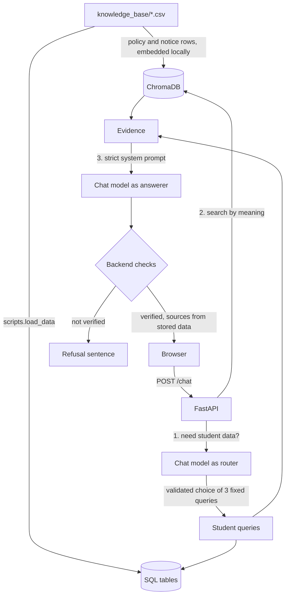

# College AI Assistant

A RAG chatbot for a college website. It answers questions **only** from the college's own data and refuses
everything else with:

> *I couldn't find this information in the college knowledge base.*

It never answers from general knowledge. Every answer lists its sources (document and page, or the exact database query).

The project includes a demo college website (a fictional "Greenfield Institute of Technology") with an **Ask AI**
button that opens the chatbot. All data is **fictional demo data**, including the 1,500 students.

## Tech stack

| Part | Technology |
|---|---|
| Backend | Python, FastAPI, Pydantic |
| Frontend | Plain HTML, CSS and JavaScript (no framework) |
| Chat model | Any OpenAI-compatible API. Default: **Groq free tier** (`openai/gpt-oss-20b`) |
| Embeddings | ChromaDB's bundled `all-MiniLM-L6-v2` model, runs locally and free |
| Vector database | ChromaDB (local) |
| Structured database | SQLite by default, or Supabase Postgres (via SQLAlchemy) |
| Tests | pytest |

Everything is free to run. No LangChain: the retrieval pipeline is plain Python so it is easy to read and explain.

## How it works



**Two kinds of questions**
- **Exact data about the 1,500 students** ("What is Ankit Raman's CGPA?", "How many CSE students are below 65% attendance?").
  The model can only choose one of three fixed, parameterized queries (`find_student`, `list_students`, `student_summary`) and
  fill in validated arguments. **The model never writes SQL.** Results are capped at 10 rows.
- **Policies, notices, hostel, exams, faculty, courses, placements, events:** found by meaning using embeddings.

**How "answer only from the knowledge base" is enforced (not only by the prompt)**
1. If the database finds nothing and no snippet is close enough, the refusal is returned without even asking the model to answer.
2. A strict system prompt, with all retrieved text treated as untrusted data (prompt injection resistant).
3. The model must say whether the answer is supported and which evidence it used. If it claims support without naming
   evidence, or names evidence that was never supplied, the backend discards the answer and returns the refusal.
4. Sources shown to the user come from stored data, never from text the model writes, so they cannot be invented.
5. If the model, embeddings or database fail, the API returns an error (shown in red) and never a made-up answer.

## What is in the knowledge base (`knowledge_base/`)

| File | Rows | Purpose |
|---|---|---|
| `students.csv` | 1,500 | exact SQL lookups only |
| `departments.csv`, `faculty.csv`, `courses.csv` | 5, 9, 11 | semantic search |
| `regulations.csv`, `exams.csv`, `hostel.csv`, `placements.csv`, `events.csv`, `notices.csv` | 8, 2, 5, 3, 5, 5 | semantic search |

To use your own data, replace the CSV files (keep an `id` column as the first column) and run `load_data` again.

## Project structure

```
backend/
  main.py            FastAPI app, serves the frontend
  config.py          settings read from .env
  database.py        SQL tables (SQLAlchemy)
  models.py          Pydantic request/response models
  routes/chat.py     POST /chat
  rag/
    router.py        picks a student query (validated)
    student_tools.py the 3 fixed SQL queries
    retrieval.py     vector search + distance cutoff
    embeddings.py    local embedding model
    vectorstore.py   ChromaDB collection
    prompts.py       strict system prompt and router prompt
    generation.py    answer + backend verification
    llm.py           one client for any OpenAI-compatible API
    knowledge_base.py loads the CSV files
frontend/
  index.html, site.css, site.js          demo college website + Ask AI button
  assistant.html, style.css, script.js   the chat page (light/dark theme)
knowledge_base/      the CSV data
scripts/             load_data, evaluate, make_students
tests/               pytest suite
```

## Setup and run

You need **Python 3.12 or 3.13** (3.14 may not have packages for ChromaDB yet) and a free Groq API key.

**1. Get a free chat-model key.** Create a key at https://console.groq.com/keys (no credit card). Other free options are
listed in `.env.example` (Google Gemini, or a fully offline local Ollama).

**2. Install** (Windows PowerShell, from the project folder):

```powershell
py -3.13 -m venv .venv
.\.venv\Scripts\python.exe -m pip install -r requirements.txt
copy .env.example .env
```

On macOS/Linux use `python3.13 -m venv .venv`, `.venv/bin/python -m pip install -r requirements.txt` and `cp .env.example .env`.

**3. Add your key.** Open `.env` and set `LLM_API_KEY=` to your key (no quotes or spaces). Never commit `.env`.

**4. Load the data** (once, and again after editing any CSV). The first run downloads the ~80 MB embedding model.

```powershell
.\.venv\Scripts\python.exe -m scripts.load_data
```

**5. Start the server.**

```powershell
.\.venv\Scripts\python.exe -m uvicorn backend.main:app --reload
```

Open http://127.0.0.1:8000 for the demo college website. Click **Ask AI** at the bottom right.
The chat page alone is at http://127.0.0.1:8000/assistant.html.

> If you see `No module named uvicorn`, you ran plain `python` instead of the project's `.venv`. Use the commands above.
> The server reads `.env` only at startup, so restart it after changing the key.

## Example questions

- What is the attendance policy?
- What time do the hostel gates close?
- When do the December 2025 exams begin? (two notices disagree, so the answer reports both)
- How many CSE students have attendance below 65%?
- Who are the top 5 students in ECE third year?
- What is the CGPA of Ankit Raman?
- What is the capital of France? (refused)

## Configuration (`.env`)

| Variable | Default | Meaning |
|---|---|---|
| `LLM_BASE_URL` | Groq URL | any OpenAI-compatible endpoint |
| `LLM_API_KEY` | none | your free key (empty is fine for local Ollama) |
| `LLM_MODEL` | `openai/gpt-oss-20b` | chat model. Providers retire models, so if you get "model not found", list current ones at `<LLM_BASE_URL>/models` |
| `TOP_K` | 8 | snippets retrieved per question |
| `MAX_DISTANCE` | 0.65 | farther snippets are dropped (measured on this embedding model) |
| `DATABASE_URL` | empty | empty = local SQLite. For Supabase use the Postgres URL with the `postgresql+psycopg://` prefix |
| `DATA_DIR` | `./data` | where the SQLite file and vector index are stored |

## API

| Endpoint | Purpose |
|---|---|
| `GET /health` | health check |
| `POST /chat` with `{"question": "..."}` | returns `answered`, `answer`, `sources`. Errors: 422 bad input, 429 model rate limit, 503 a service is down |

Chat is open to everyone. There is no document upload or admin interface.

## Tests

```powershell
.\.venv\Scripts\python.exe -m pytest -q                 # 90 offline tests, no API key needed
.\.venv\Scripts\python.exe -m scripts.evaluate          # 20 live questions against the real model (needs your key)
```

The offline tests use the real local embeddings and a scripted fake chat model, so they never call a paid or external
service. They cover the data, the student queries (checked against the CSV), different wordings of one question, refusals,
citations, prompt injection, SQL injection, a misbehaving model, outages and the website. The last live run
passed 20 of 20 with Groq `openai/gpt-oss-20b`.

`python -m scripts.make_students` regenerates the 1,500 fictional students (seeded, so the output is identical each time).

## Limitations

- **Privacy:** anyone can look up student records (name, CGPA, attendance, email). This is fine for fictional data.
  A real deployment would need login and per-student access rules.
- The small embedding model is weak with numbers: "I have 70% attendance" may not surface the 65-75% condonation rule.
- No conversation memory: each question stands alone, so a follow-up like "what about his attendance?" is not understood.
- Free model tiers have limits (about 30 requests per minute on Groq). Rapid use shows a "busy, try again" message.
  Free tiers may also use prompts, so never send real student data to them.
- Answer wording varies slightly between runs. The backend checks keep every answer grounded and cited.
- Supabase Postgres is supported through `DATABASE_URL` but has not been tested against a live project.
